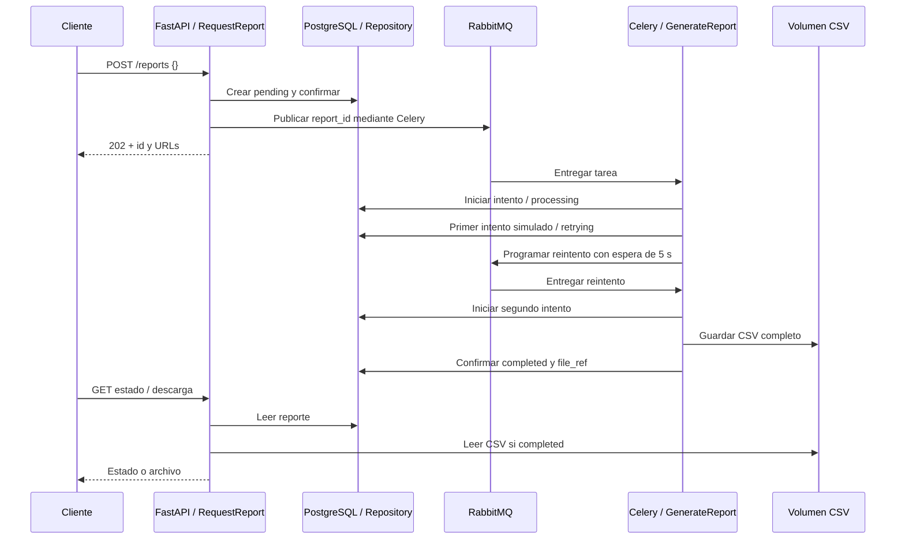

# Design

## Context

Ver `proposal.md` para la motivación y `specs/report-generation/spec.md` para el contrato observable. La carpeta estaba vacía; OpenSpec documenta una aplicación futura. Este cambio entrega el SDD y deja toda implementación pendiente.

## Goals / Non-Goals

**Goals:** mantener separados transporte, negocio y persistencia; compartir casos de uso entre API y worker; permitir pruebas con dependencias falsas; hacer visibles los límites de transacción y reintento.

**Non-Goals:** garantías de ejecución exactamente una vez, recuperación automática ante caídas, consumidores concurrentes del mismo reporte, outbox, caché, frontend, autenticación, servicios externos o almacenamiento distribuido. El entorno es una demostración local, no un despliegue productivo.

## Decisions

### 1. Acuerdos y valores predeterminados

Acuerdos de la conversación: capas, Repository, inyección de dependencias, SOLID/KISS, FastAPI, Celery, RabbitMQ, PostgreSQL, SQLModel, dominio independiente del ORM, datos ficticios, CSV compartidos, Docker Compose y simulación de fallo claramente comentada. Sin Redis.

Valores definidos para concretar esta prueba: Python 3.12, gestión con `uv`, SQLModel con sesiones síncronas y driver Psycopg 3, Alembic para migraciones y pytest para pruebas. No se fijan aquí versiones de paquetes no verificadas: la implementación resolverá versiones compatibles y generará `uv.lock`. Imagen Python 3.12, PostgreSQL 16 y RabbitMQ 4 con interfaz de administración; las etiquetas concretas y dependencias se validarán al implementar.

Los endpoints no reciben filtros en esta versión: `ReportCreate` acepta únicamente `{}`, con campos extra prohibidos. El reporte siempre contiene 100 ventas. Esto evita incorporar filtros y datos externos sin un requisito que los justifique.

### 2. Capas y composición

```text
app/
  presentation/       # API, esquemas de transporte y tareas Celery
  application/        # Casos de uso, errores de aplicación y contratos
  domain/             # Report, ReportStatus y transiciones
  infrastructure/     # SQLModel, Celery publisher, CSV y almacenamiento
  bootstrap/          # Configuración y construcción de dependencias
```

Presentación depende de aplicación. Aplicación depende de dominio y de contratos propios. Infraestructura implementa esos contratos. Dominio no importa FastAPI, Celery, Pydantic, SQLModel ni SQLAlchemy. Solo la composición conoce las implementaciones concretas. Aplicación no abre conexiones ni importa frameworks.

FastAPI usa `Depends` para obtener casos de uso, construidos por funciones. La tarea Celery llama a una función de composición equivalente. Los constructores reciben las dependencias; no habrá contenedor adicional, repositorio genérico, bus de eventos interno ni clases base para cada capa.

Se utilizarán tres casos de uso: `RequestReport`, `GenerateReport` y `GetReport`. `GetReport` también permite obtener la referencia necesaria para la descarga; no se crea un caso de uso adicional solo para renombrar esa consulta.

Contratos mínimos de aplicación:

| Contrato | Operaciones previstas | Implementación |
|---|---|---|
| `ReportRepository` | `get(UUID) -> Report or None`, `add(Report)`, `save(Report)`, `transaction() -> ContextManager[None]` | Repositorio SQLModel |
| `ReportTaskPublisher` | `publish(report_id: UUID) -> None` | Publicación Celery |
| `ReportGenerator` | `generate(report_id: UUID, attempt: int) -> bytes` | Generador CSV con simulación configurable |
| `ReportStorage` | `write(report_id: UUID, content: bytes) -> str` | Archivos locales; devuelve referencia relativa |

La descarga resuelve la referencia dentro del directorio de reportes mediante el adaptador de almacenamiento y entrega el archivo desde presentación. Las rutas físicas no forman parte de las respuestas públicas. Los contratos no retornan objetos ORM, sesiones o `AsyncResult`.

### 3. Modelos y persistencia

- `Report`: entidad Python del dominio; UUID, estado, intentos, fechas, referencia del archivo y error público. `ReportStatus` es un enum de cadenas.
- `ReportTable`: tabla SQLModel en infraestructura. El repositorio convierte entre tabla y entidad.
- `ReportCreate` y `ReportResponse`: modelos SQLModel sin tabla, en presentación; actúan como esquemas Pydantic. La respuesta de aceptación tiene su propio esquema pequeño.

La tabla `reports` contiene `id` (UUID PK), `status` (cadena), `attempts` (entero inicialmente 0), `created_at`, `started_at`, `finished_at` (fechas UTC; las dos últimas anulables), `file_ref` y `error_code` (anulables). El estado persistido es la fuente de la API; no se configura backend de resultados de Celery y se ignoran sus resultados.

`started_at` representa el primer intento. `finished_at` se asigna al completar o fallar. `file_ref` se asigna solo después de guardar correctamente el CSV. `attempts` aumenta al iniciar cada intento, incluida la simulación. El error temporal se limpia al completar.

La migración inicial crea la tabla; arrancar la API no ejecuta `create_all`. El repositorio no confirma cada operación por separado. El caso de uso delimita bloques con `repository.transaction()`, cuya implementación hace commit o rollback y no filtra sesiones al caso de uso. Todas las lecturas y escrituras se realizan dentro de esos bloques para evitar transacciones implícitas abiertas.

API y worker usan sesiones distintas. La sesión se cierra al terminar la petición o tarea. Engines y conexiones del worker se crean dentro de sus procesos, nunca se heredan conexiones abiertas de la API. Se usan endpoints síncronos para estas operaciones y SQL síncrono en Celery, evitando puentes de event loop innecesarios.

### 4. Solicitud, publicación y ejecución



`RequestReport` genera el UUID y confirma `pending` antes de llamar al publisher. Publicar no vuelve a escribir `pending`: el worker podría haber avanzado antes de la respuesta HTTP. La respuesta de aceptación tampoco promete un estado que ya pudo cambiar.

El publisher usa el protocolo Celery, argumentos JSON y cola `reports`; transmite únicamente `report_id` como cadena UUID. `task_id` puede fijarse al mismo UUID para correlación, pero no se usa como mecanismo de deduplicación. Se habilitan confirmaciones de publicación del transporte RabbitMQ y un límite de conexión/publicación de cinco segundos, sin reintentos indefinidos en la petición. `202` no garantiza la finalización futura ni la supervivencia de una caída posterior.

La tarea Celery recibe el identificador, construye dependencias y llama a `GenerateReport`. Un primer bloque transaccional lee el registro, omite reportes terminales y registra `processing`, inicio e incremento de intentos. La generación y escritura del archivo ocurren fuera de la transacción. Un segundo bloque registra el resultado o error.

La tarea traduce únicamente `TemporaryReportError` a `retry(countdown=5, max_retries=2)`. El caso de uso registra `retrying` mientras quedan reintentos y `failed` al agotar el presupuesto; ante error permanente registra `failed` inmediatamente. El límite también se comprueba con `attempts` persistidos. Las excepciones de aplicación son independientes de Celery. Errores al programar el reintento se registran como fallo terminal si la base de datos continúa disponible.

Un encargo para `completed` se omite sin cambiar archivo, fechas o intentos. Un encargo para `failed` también se omite: no hay relanzamiento manual en esta versión. El entorno inicial tiene un worker con concurrencia 1 y prefetch 1; no se promete exclusión entre workers concurrentes ni recuperación de un reporte que quede `processing` por una caída abrupta.

### 5. Simulación y CSV

`SIMULATE_TRANSIENT_FAILURE=true` en el entorno de demostración. El adaptador del generador lanza `TemporaryReportError` cuando `attempt == 1`, antes de escribir archivos. Desactivarlo permite terminar en el primer intento. El fallo no se introduce en la entidad, el repositorio ni el endpoint.

El comentario junto al punto de fallo dirá:

> Fallo intencional para demostrar los reintentos de Celery. La primera ejecución falla y el siguiente intento continúa normalmente. Esta simulación es educativa y debe desactivarse fuera de la prueba.

No se añade un endpoint público para provocar errores. El agotamiento se prueba con un generador falso que siempre lanza el error transitorio, y los errores permanentes con un generador falso que lanza un error no recuperable.

El CSV usa UTF-8, delimitador coma y saltos de línea `\n`; encabezado `sale_id,customer,total,currency`. Para cada entero `n` del 1 al 100: `sale_id=n`, `customer=Cliente NNN` con tres dígitos, `total=Decimal(n) * Decimal("10.00")` formateado a dos decimales, `currency=PEN`. No utiliza reloj, aleatoriedad, floats ni consultas a ventas reales.

El nombre final es `report-{id}.csv`. El adaptador escribe primero un temporal en el mismo directorio y lo sustituye atómicamente antes de marcar `completed`. Se intenta limpiar temporales ante error. Se utilizan referencias relativas generadas internamente, sin aceptar rutas del cliente.

### 6. Contratos HTTP y estados

| Operación | Respuesta |
|---|---|
| `POST /reports`, cuerpo obligatorio `{}` | `202`: `id`, `status_url`, `download_url` |
| `GET /reports/{id}` | `200`: `id`, `status`, `attempts`, `created_at`, `started_at`, `finished_at`, `download_url`, `error_code` |
| `GET /reports/{id}/download` | `200`: `text/csv`, attachment `report-{id}.csv` |
| UUID inexistente, consulta o descarga | `404`, código `report_not_found` |
| UUID o cuerpo inválido | `422`, validación del framework |
| Descarga antes de completar, incluido failed | `409`, código `report_not_ready` |
| CSV completado pero ausente | `410`, código `report_file_missing` |
| Persistencia o publicación no disponible al aceptar | `503`, código `persistence_unavailable` o `publication_failed` |

Las URLs son relativas. `download_url` en la consulta es null hasta completar; las fechas ausentes y `error_code` sin error son null. Los errores de aplicación usan `detail` con `code` y `message`; el fallo de publicación incluye además `report_id` porque ya existe un registro. No se exponen trazas, rutas locales ni cadenas de conexión.

Transiciones permitidas: `pending → processing`, `processing → retrying/completed/failed`, `retrying → processing/failed` y `pending → failed` ante fallo detectado de publicación. La finalización correcta no pasa después por `failed`. Las transiciones se verifican en dominio; el repositorio no decide reglas.

### 7. Entorno y alternativas

Compose define `api`, `worker`, `rabbitmq` y `postgres`. API y worker comparten imagen Python y volumen `/app/reports`; PostgreSQL y RabbitMQ tienen volúmenes persistentes. El proceso puntual de migración reutiliza la imagen antes de iniciar API y worker. Se documentan healthchecks y orden de arranque.

Puertos locales predeterminados: API `8000`, administración RabbitMQ `15672`; PostgreSQL y AMQP pueden permanecer en la red interna de Compose. Las credenciales de ejemplo se declaran explícitamente locales y se usa un usuario RabbitMQ propio, no `guest` entre contenedores. Los logs incluyen `report_id`, intento y etapa; no se agregan Flower ni métricas en esta versión.

Alternativas consideradas:

- Redis como broker: menos infraestructura, pero se eligió RabbitMQ para aprender ese transporte.
- RabbitMQ + Redis backend: innecesario si el estado público ya está en PostgreSQL; se evita duplicar fuentes de estado.
- Backend RPC de RabbitMQ: no es necesario para consultas HTTP desde procesos distintos; se conserva seguimiento propio en PostgreSQL.
- SQLAlchemy y Pydantic separados: válidos, pero se eligió SQLModel para simplificar declaraciones manteniendo modelos y dominio separados.
- Python local y servicios Docker: facilita depurar, pero se eligió Compose completo para un arranque reproducible.
- Outbox y control de concurrencia distribuida: ampliarían garantías, pero exceden la demostración aprobada.

## Risks / Trade-offs

- [Commit y publicación no atómicos] → publicar solo después de confirmar; ante error detectado, intentar marcar `failed` y responder `503`. Una caída entre operaciones puede dejar `pending` sin mensaje. Un error de confirmación puede ser ambiguo: no se promete que ningún mensaje haya llegado.
- [Aceptación ambigua y solicitudes repetidas] → documentar que repetir `POST` crea otro reporte; no hay clave de idempotencia ni garantía exactamente una vez.
- [Caída del worker o fallo de base de datos al registrar estado] → logs correlacionados y diagnóstico manual. No se garantiza transición final ni recuperación automática bajo estas caídas.
- [Archivo guardado y commit final fallido] → puede quedar un archivo sin estado completado; no se ofrece descarga hasta completar y se documenta limpieza manual del entorno.
- [Archivo perdido después de completar] → devolver `410`; el volumen no sustituye almacenamiento compartido de producción.
- [Simulación confundida con error real] → comentario explícito, variable de configuración y README que explica cómo desactivarla.
- [Dos workers procesando el mismo identificador] → limitar el entorno inicial a un worker con concurrencia 1; solo se garantiza omisión de encargos recibidos después de completar, no exclusión concurrente.

## Migration Plan

En la implementación futura: resolver dependencias y lockfile, construir la imagen, arrancar PostgreSQL y RabbitMQ, ejecutar la migración inicial y arrancar API y worker. Verificar el recorrido descrito en la especificación. No hay datos previos que migrar.

La guía distinguirá detener servicios conservando volúmenes de reiniciar destructivamente el laboratorio. El cambio OpenSpec permanecerá abierto hasta implementar y verificar sus tareas; preparar estos documentos no autoriza archivarlo ni marcar tareas como hechas.
